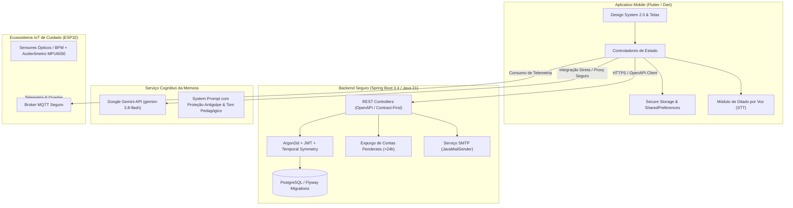

# Visão Geral e Arquitetura do Projeto Memora

> **Documento de Especificação Técnica e Funcional**  
> *Destinado a análise arquitetural, validação de escopo e levantamento de sugestões de novas funcionalidades por Inteligência Artificial.*

---

## 1. Identificação do Projeto e Propósito

- **Nome do Projeto**: Memora
- **Natureza**: Projeto Integrador — FATEC Americana (Curso de Análise e Desenvolvimento de Sistemas).
- **Equipe**: NewXz (Eduardo Juncker Toras, Eduardo Moraes Trevisan, Henrique Moreira Sandrini).
- **Orientação**: Prof. Dr. Ivan Menerval da Silva.
- **Público-Alvo**: Pessoas idosas brasileiras (60+ anos), seus familiares e cuidadores.
- **Tese Central de Valor**: Diferente de assistentes convencionais (Google Assistente, Siri, Alexa) que apenas *executam tarefas* pelo usuário, o Memora é um **companheiro digital pedagógico que ensina o caminho** com paciência, passo a passo, linguagem simples e proteção preventiva antigolpe, promovendo a autonomia digital do idoso. Além disso, incorpora **monitoramento preventivo de saúde e detecção de quedas via IoT**.

---

## 2. Princípios Constitucionais e Inegociáveis

1. **Pedagogia sobre Automação**: O aplicativo explica o caminho com capturas reais anotadas, sem pressa. Da próxima vez, a pessoa consegue fazer sozinha.
2. **Segurança Proativa e Prevenção Antigolpe**:
   - O Memora **nunca solicita senhas, códigos de confirmação, transferências bancárias ou PIX**.
   - Em todas as telas de conversa e alertas críticos, há faixas antigolpe permanentes e avisos de contexto.
   - Respostas da assistente que envolvam bancos ou serviços governamentais nunca acionam transações em segundo plano.
3. **Acessibilidade Sênior Extrema (WCAG 2.2 AA/AAA)**:
   - **Tipografia**: Tipografia oficial *Atkinson Hyperlegible Next* com tamanho mínimo de `16 sp`.
   - **Ampliação de Texto**: Suporte nativo a até **200% de escala de texto** sem nenhum *overflow* ou quebra de layout.
   - **Alvos de Toque**: Alvos mínimos táteis de `48×48 dp` (e `56 dp` para decisões e ações primárias).
   - **Separação Rígida entre Informação e Ação (`002/FR-012`)**: Componentes de leitura de informação (`Cartao`, `PainelHeroi`, `BadgeDeStatus`, `CaixaDeEtapa`, `CampoInformacao`, `ListaInformacao`) são estritamente informativos e não emitem semântica nem resposta a toque; componentes interativos possuem pistas táteis explícitas (setas, anéis de foco, bordas e feedback tátil).
   - **Zero Literais Visuais Fora dos Tokens**: Toda cor, dimensão, elevação e raio é centralizado em tokens validados por scripts de auditoria automatizados.
   - **Contraste Rígido**: Conformidade matemática com WCAG 2.2 em 13 combinações de temas (Claro, Escuro, Alto Contraste) e 6 paletas de cores.
4. **Privacidade e Proteção de Dados (LGPD / Princípio II)**:
   - Explicação prévia em português claro antes de solicitar qualquer permissão do sistema (microfone, notificações).
   - Sem envio automático de rascunhos de voz: o ditado apenas preenche o campo para revisão da pessoa usuária antes do envio explícito.
   - Desativação completa de backups na nuvem do Android (`allowBackup="false"`) para evitar vazamento de credenciais locais.

---

## 3. Arquitetura e Stack Tecnológica

- **Frontend Mobile**: Flutter (Dart), arquitetura limpa em camadas (`domain`, `data`, `presentation`), desacoplamento por contratos e dublês de teste completos.
- **Design System 2.0**: Baseado em tokens semânticos (`MemoraCores`, `MemoraDimensoes`, `MemoraTipografia`, `MemoraElevacao`, `MemoraRaio`), mascote unificado com 6 expressões (`ExpressaoDaMemora`), navegação inferior elevada de 3 abas (`Ajustes`, `Início`, `Meu perfil`).
- **Backend**: Spring Boot 3.4, Java 21, Spring Security com hash Argon2id em tempo constante, Spring Data JPA, Flyway, PostgreSQL, Spring Mail.
- **Inteligência Artificial**: Google Gemini API via modelo leve e responsivo (`gemini-3.8-flash`), orientada por system prompts rigorosos de pedagogia sênior e prevenção a fraudes.
- **Hardware IoT**: Módulos ESP32 com sensores de pulso (MAX30102 / óptico) e acelerômetro/giroscópio para detecção de anomalias cinemáticas e quedas súbitas.

---

## 4. Módulos e Funcionalidades Implementadas (Features 001 a 007)

### 4.1. Autenticação e Gestão de Contas (Feature 001 & 006)
- **Cadastro e Boas-Vindas**: Fluxo acolhedor, sem jargões como "username" ou "password", utilizando linguagem do dia a dia ("Como quer ser chamado(a)", "Seu telefone ou e-mail", "Crie sua palavra-chave").
- **Proteção contra Enumeração e Timing Attacks**: Resposta chamariz idêntica em tempo constante para contas já existentes ou em confirmação, preservando a privacidade do idoso.
- **Validação de Código e Recuperação de Acesso**: Entrega de código numérico simples de 6 dígitos via e-mail real (SMTP em produção) ou SMS, com mensagens sem links clicáveis externos (evitando ataques de phishing).
- **Expurgo Automático de Contas Abandonadas (`T065b`)**: Expurgo transacional agendado e sob demanda de cadastros pendentes há mais de 24 horas, liberando o contato para novo uso sem reter dados órfãos.
- **Sessão Segura e Limpeza Total**: Armazenamento em chaveiro seguro local, monitoramento de inatividade e encerramento limpo sem retenção de segredos.

### 4.2. Início, Hub de Portas e Navegação (Feature 003, 004 & 007)
- **Saudação Humanizada e Contexto**: Saudação direta com avatar do robô Memora (`"Oi, [Nome]!"`) e resumo claro do que fazer.
- **Cartão Herói de Conversa**: Ponto focal primário com pista visual explícita para início imediato de diálogo com a assistente.
- **Grade 2x2 de Atalhos Rápidos**: Portas principais com ícones em badges tonais (`Meus aplicativos`, `Serviços sociais`, `Cuidado`, `Ajuda`), projetadas para caber em telas compactas (`360×640` e `320×568`) sem necessidade de rolagem desnecessária.
- **Hub Central ("Tudo o que eu faço")**: Catálogo de módulos em cartões verticais espaçosos, com descrições curtas e botões de ação dedicados.
- **Barra de Navegação Inferior Elevada**: Fixa em 3 destinos obrigatórios (`Ajustes`, `Início`, `Meu perfil`), com separador sutil, pílula tonal ativa e rótulo textual obrigatório ao lado do ícone.

### 4.3. Conversa com a Memora e Assistente Pedagógica (Feature 003, 004 & 007)
- **Aceite Prévio de Privacidade Descomplicado**: Antes do primeiro uso, a Memora explica em linguagem natural o que é a IA, o que ela faz e que dados não devem ser digitados (senhas, documentos).
- **Aviso Antigolpe Colapsável (`AvisoCompacto`)**: Faixa persistente com ícone de escudo reforçando: *"Eu nunca peço sua senha"*. Pode ser recolhido para liberar espaço visual na conversa.
- **Sugestões Rápidas de Diálogo**: Antes do envio da primeira mensagem, exibe pílulas de perguntas frequentes do cotidiano (ex.: *"Como vejo fotos do meu neto?", "Como mando mensagem no WhatsApp?"*).
- **Balões de Diálogo Espaçosos**: Balões da assistente com fundo branco elevado e mini-robô; balões do usuário no tom da paleta escolhida, garantindo alta legibilidade.
- **Ditado por Voz Acessível (`FR-013`)**:
  - Botão de alternância com texto e ícone claros (`"Falar"` / `"Parar"`).
  - Diálogo explicativo amigável antes de disparar o pedido de permissão do microfone ao Android.
  - O áudio transcrito preenche **apenas o rascunho de texto** no campo de entrada; o envio exige o toque explícito no botão `"Perguntar"` (prevenção contra envios acidentais por ruído ambiente).

### 4.4. Guias Passo a Passo e Tutoriais de Aplicativos (Feature 005 & 006)
- **Catálogo de Aplicativos Cotidianos e Serviços Sociais**:
  - Apps de comunicação e mídia: WhatsApp, YouTube, Facebook, Instagram, Google Fotos.
  - Apps de utilidade e cidadania: Gov.br, Carteira de Trabalho Digital (CLT), CNH Digital, Poupatempo, Correios, Meu INSS, Cadastro Único, MEI.
- **Leitor Passo a Passo Editorial**:
  - Indicador linear de progresso e numeração de etapa clara.
  - Telas reais capturadas e rigorosamente **sanitizadas** (sem dados pessoais, números de documentos, fotos privadas ou barras de sistema).
  - Marcações visuais numeradas de alto contraste sobre as telas reais, apontando com precisão onde o dedo deve tocar.
  - Botões inferiores de navegação `"Voltar passo"` e `"Próximo passo"` amplos e confortáveis.

### 4.5. Módulo de Cuidado & Saúde IoT (Feature 005 & 007)
- **Painel Herói de Saúde**: Gradiente acessível no topo com o estado do dispositivo (`Conectado / Desconectado`), batimentos cardíacos em tempo real (`BPM`) com medição simulada ou via pulseira ESP32.
- **Telemetria de Movimento e Orientação**: Indicadores simplificados de movimentação (`Parado`, `Em movimento normal`, `Movimento brusco`).
- **Verificação Crítica de Queda (`TelaVerificacaoQueda`)**:
  - Disparada ao detectar aceleração brusca compatível com queda.
  - Cronômetro regressivo sonoro e visual de segurança (45 segundos).
  - Decisões em botões de altíssimo contraste e tamanho aumentado: `"Estou bem"` (cancela o alerta) e `"Preciso de ajuda"` (dispara notificação imediata ao cuidador).
  - Aviso reforçado de que o alarme nunca cobra valores ou solicita dados financeiros.
- **Contato de Emergência**: Cadastro de familiar ou cuidador de confiança com nome, parentesco e telefone para acionamento em um toque.

### 4.6. Configurações, Preferências de Acessibilidade e Perfil (Feature 004 & 007)
- **Personalização de Aparência (`TelaAparencia`)**:
  - Modos de tema: `Claro`, `Escuro` e `Alto Contraste` (fundo preto puro, texto amarelo e bordas espessas de máxima visibilidade).
  - Paletas de cor: Azul Acolhedor, Verde Esperança, Roxo Conforto, Laranja Terra, Rosa Suave e Grafite Neutro.
  - Modos de animação: Opção explícita para reduzir movimento e desativar transições cinéticas.
- **Transparência e Privacidade**: Explicações objetivas sobre o que fica gravado no aparelho e botão claro para esquecer histórico de conversas.
- **Perfil do Usuário**: Nome de tratamento, data de nascimento/faixa etária para adequação de vocabulário e opção segura para sair da conta.

---

## 5. Diretrizes para Avaliação e Sugestão de Novas Funções

Ao submeter este projeto para validação por uma IA especialista em Produto e Arquitetura, os seguintes pontos focais devem nortear as sugestões:

1. **Aderência ao Público Sênior**: Qualquer nova função deve respeitar o princípio de não sobrecarregar cognitivamente a pessoa usuária, evitando excesso de notificações, fluxos ramificados complexos ou termos em inglês.
2. **Potencial de Expansão da Autonomia Digital**: Sugestões que ajudem o idoso a identificar fake news, mensagens suspeitas de golpe no WhatsApp, boletos falsos ou fraudes bancárias.
3. **Evolução do Módulo de Cuidado & IoT**: Recursos adicionais para teleassistência familiar (ex.: acompanhamento de remédios em horários programados, botão de pânico simplificado na tela inicial, geofencing seguro sem invasão de privacidade).
4. **Interação por Voz e Multimodalidade**: Recursos de áudio-leitura dos tutoriais para idosos com baixa visão ou analfabetismo funcional.
5. **Gamificação Pedagógica Leve**: Reforço positivo da aprendizagem sem gerar estresse ou sensação de cobrança escolar.
