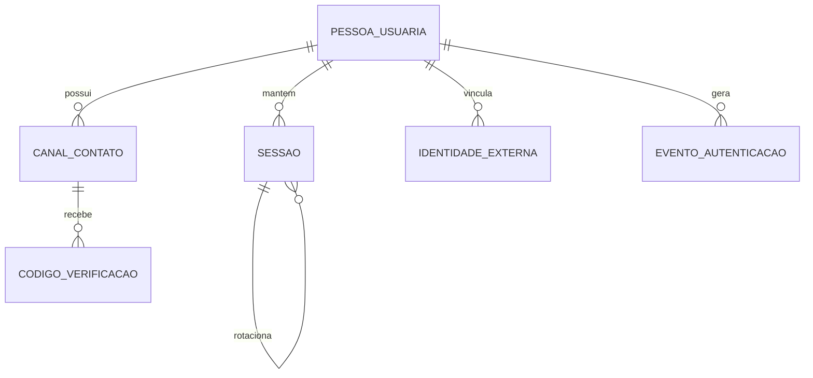

# Fase 1 — Modelo de Dados: Autenticação Acessível

**Feature**: 001-autenticacao-acessivel
**Data**: 2026-07-24

> Toda coluna é classificada conforme a Constituição: **Público**, **Interno**,
> **Confidencial** ou **Sensível**. Campos Sensíveis exigem tratamento criptográfico
> e nunca aparecem em log ou em resposta de API.

---

## Visão geral



---

## PESSOA_USUARIA

Quem usa o Memora.

| Campo | Tipo | Classificação | Regras |
|---|---|---|---|
| `id` | UUID | Interno | Chave primária. **UUID, não sequencial** — ver nota abaixo |
| `nome_tratamento` | texto (80) | Interno | Como a pessoa quer ser chamada. **Nunca é credencial** (FR-003) |
| `senha_hash` | texto | **Sensível** | Argon2id (R1). Nulo quando a conta usa apenas login social |
| `estado` | enum | Interno | `ativa`, `bloqueada_temporariamente`, `desativada` |
| `criada_em` | timestamp | Interno | |
| `ultimo_acesso_em` | timestamp | Interno | |
| `falhas_consecutivas` | inteiro | Interno | Reiniciado a cada entrada bem-sucedida |
| `bloqueada_ate` | timestamp | Interno | Nulo quando não há bloqueio |

**Nota sobre `id`**: identificador sequencial permitiria deduzir quantas pessoas
usam o sistema e facilitaria IDOR. A Constituição proíbe expor ID interno
desnecessariamente — UUID resolve os dois problemas.

**Regras de negócio**:
- Deve existir **pelo menos um** canal de contato verificado ou uma identidade
  externa vinculada.
- `senha_hash` nulo só é válido se houver ao menos uma identidade externa (FR-053).

---

## CANAL_CONTATO

E-mail ou telefone. Uma pessoa pode ter os dois (D1), mas o cadastro exige apenas um.

| Campo | Tipo | Classificação | Regras |
|---|---|---|---|
| `id` | UUID | Interno | |
| `pessoa_id` | UUID | Interno | FK para `PESSOA_USUARIA` |
| `tipo` | enum | Interno | `email` ou `telefone` |
| `valor` | texto | **Confidencial** | Normalizado: minúsculas e sem espaços |
| `valor_hash` | texto | Interno | Índice de busca sem varrer o valor em claro |
| `verificado` | booleano | Interno | **Só canal verificado serve para recuperação** (FR-052) |
| `verificado_em` | timestamp | Interno | |
| `principal` | booleano | Interno | O canal escolhido no cadastro |
| `criado_em` | timestamp | Interno | |

**Regras de negócio**:
- `(tipo, valor)` é **único em todo o sistema** — impede duas contas com o mesmo
  e-mail.
- Login aceita **qualquer** canal cadastrado da pessoa, verificado ou não (FR-051).
  > Esta linha dizia "qualquer canal **verificado**" até 2026-08-15. Estava errada
  > por dois motivos: a FR-051 fala em canais *cadastrados*, e o cadastro cria o
  > canal como não verificado — exigir verificação aqui deixaria toda conta nova
  > sem conseguir entrar. No login quem autentica é a senha; o canal só localiza a
  > conta. Decisão da equipe, registrada na T047.
- Um canal **não verificado nunca** recebe código de recuperação. É a defesa contra
  o cenário do acompanhante que cadastra o próprio contato (FR-062). **É aqui, e
  não no login, que a verificação é obrigatória** (FR-052).

**Transições de estado**:

```
criado (verificado=false)
   │ código correto dentro do prazo
   ▼
verificado (verificado=true)  ──── apto a recuperar acesso
```

---

## IDENTIDADE_EXTERNA

Vínculo com Google ou Facebook (D2).

| Campo | Tipo | Classificação | Regras |
|---|---|---|---|
| `id` | UUID | Interno | |
| `pessoa_id` | UUID | Interno | FK |
| `provedor` | enum | Interno | `google` ou `facebook` |
| `subject` | texto | **Confidencial** | Identificador da pessoa **no provedor**, imutável |
| `vinculada_em` | timestamp | Interno | |

**Regras**:
- `(provedor, subject)` é único.
- Uma pessoa pode ter no máximo uma identidade por provedor.
- **Nunca** armazenar token do provedor. Ele é validado e descartado (R6).

---

## SESSAO

Sessão ativa com refresh token rotativo (R2).

| Campo | Tipo | Classificação | Regras |
|---|---|---|---|
| `id` | UUID | Interno | |
| `pessoa_id` | UUID | Interno | FK |
| `familia_id` | UUID | Interno | Agrupa a cadeia de rotações. Chave da detecção de reuso |
| `refresh_token_hash` | texto | **Sensível** | **Nunca** em texto puro |
| `substituida_por` | UUID | Interno | Nulo enquanto for o token corrente |
| `aparelho_descricao` | texto | Interno | Rótulo legível, para a pessoa reconhecer a sessão |
| `criada_em` | timestamp | Interno | |
| `expira_em` | timestamp | Interno | 60 dias, renovado a cada uso |
| `revogada_em` | timestamp | Interno | Nulo quando ativa |

**Regra crítica — detecção de reuso**:

> Se chegar um refresh token cujo registro tem `substituida_por` preenchido, ele já
> foi usado. Isso indica roubo. **Toda a `familia_id` é revogada** e a pessoa é
> notificada.

**Transições**:

```
ativa ──uso normal──► substituída (nova sessão na mesma família)
  │
  ├──logout (FR-026)──► revogada
  ├──troca de senha (FR-021)──► revogada (toda a família)
  ├──inatividade (FR-017)──► expirada
  └──reuso detectado──► revogada (toda a família) + notificação
```

---

## CODIGO_VERIFICACAO

Código de 6 dígitos para verificar posse de canal e para recuperar acesso (R5).

| Campo | Tipo | Classificação | Regras |
|---|---|---|---|
| `id` | UUID | Interno | |
| `canal_id` | UUID | Interno | FK para `CANAL_CONTATO` |
| `finalidade` | enum | Interno | `verificacao_posse` ou `recuperacao_acesso` |
| `codigo_hash` | texto | **Sensível** | Hasheado, nunca em texto puro |
| `expira_em` | timestamp | Interno | 10 minutos |
| `usado_em` | timestamp | Interno | Nulo até o uso. **Uso único** (FR-020) |
| `tentativas` | inteiro | Interno | Limite antes de invalidar |
| `criado_em` | timestamp | Interno | |

**Regras**:
- Solicitar novo código **invalida** o anterior da mesma finalidade.
- Após N tentativas erradas, o código é invalidado e é preciso solicitar outro.

---

## EVENTO_AUTENTICACAO

Trilha de auditoria (FR-039). **Somente inserção** — nunca alterada nem apagada.

| Campo | Tipo | Classificação | Regras |
|---|---|---|---|
| `id` | UUID | Interno | |
| `pessoa_id` | UUID | Interno | Nulo quando a conta não existe (evita confirmar existência) |
| `tipo` | enum | Interno | `cadastro`, `entrada`, `falha_entrada`, `bloqueio`, `recuperacao_solicitada`, `senha_alterada`, `saida`, `reuso_token_detectado`, `canal_verificado` |
| `resultado` | enum | Interno | `sucesso` ou `falha` |
| `origem_hash` | texto | **Confidencial** | Endereço de rede **hasheado** — permite correlação sem reter o dado |
| `ocorrido_em` | timestamp | Interno | |

**Proibição absoluta (FR-040)**: senha, código, refresh token ou valor de canal em
texto legível. Nunca.

---

## Índices necessários

| Tabela | Índice | Motivo |
|---|---|---|
| `CANAL_CONTATO` | `(tipo, valor)` único | Impede conta duplicada |
| `CANAL_CONTATO` | `valor_hash` | Busca no login |
| `IDENTIDADE_EXTERNA` | `(provedor, subject)` único | Vinculação (FR-057) |
| `SESSAO` | `refresh_token_hash` | Validação a cada renovação |
| `SESSAO` | `familia_id` | Revogação em massa |
| `CODIGO_VERIFICACAO` | `(canal_id, finalidade)` | Invalidar o anterior |
| `EVENTO_AUTENTICACAO` | `(pessoa_id, ocorrido_em)` | Consulta de auditoria |

---

## Retenção

| Dado | Retenção | Motivo |
|---|---|---|
| Sessão revogada ou expirada | 30 dias | Investigar incidente, depois apagar |
| Código de verificação usado ou expirado | 7 dias | Detectar abuso |
| Evento de autenticação | 12 meses | Auditoria |
| Conta desativada | Anonimização após 30 dias | Não reter dado pessoal sem finalidade |

---

## O que este modelo deliberadamente NÃO tem

- **Vínculo de familiar/acompanhante.** O modo assistido (D3) é um caminho de
  interface, não um relacionamento persistido. A FR-064 é explícita: o modo
  assistido não cria vínculo, permissão ou acesso do acompanhante. Modelar isso
  agora criaria a dependência que a feature existe para evitar.
- **Papéis e permissões.** Toda pessoa usuária é igual nesta feature. Introduzir
  papéis antes de existir necessidade é complexidade sem justificativa.
- **Token do provedor externo.** Validado e descartado (R6).
