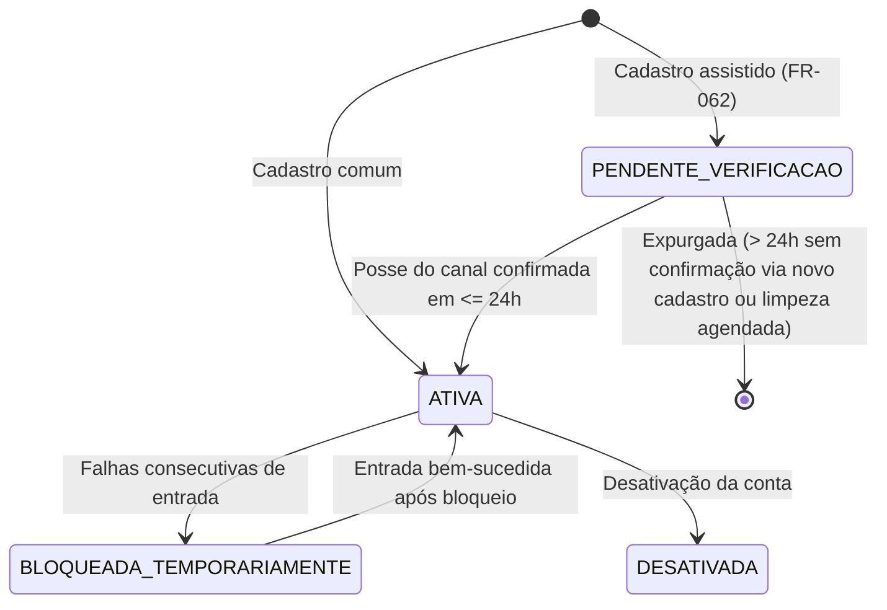

# Data Model: 006 — Polimento de Acessibilidade, Robustez de Conta e Rastreabilidade

**Feature**: [spec.md](spec.md) | **Research**: [research.md](research.md)  
**Date**: 2026-11-13  

---

## 1. Entidades de Domínio (Backend — Autenticação)

Nenhuma nova tabela ou coluna de banco de dados é necessária (o esquema Flyway `V1`–`V11` permanece inalterado). As regras de ciclo de vida operam sobre as entidades existentes:

### 1.1 `PessoaUsuaria` (`pessoa_usuaria`)

| Campo | Tipo Java / SQL | Classificação | Regra na Feature 006 |
|---|---|---|---|
| `id` | `UUID` | Interno | Identificador único da conta. |
| `estado` | `EstadoDaConta` (`VARCHAR(30)`) | Interno | Contas criadas em modo assistido nascem em `PENDENTE_VERIFICACAO`. |
| `criadaEm` | `Instant` (`TIMESTAMPTZ`) | Interno | Instante de criação da conta; usado para aferir expiração do estado `PENDENTE_VERIFICACAO` após 24 horas. |

#### Regra de domínio adicionada a `PessoaUsuaria`
- **`estaPendenteDeVerificacao()`**: retorna `true` quando `this.estado == EstadoDaConta.PENDENTE_VERIFICACAO`.
- **`estaPendenteExpirada(Instant agora, Duration prazoMaximo)`**: retorna `true` quando `this.estado == EstadoDaConta.PENDENTE_VERIFICACAO` e `!this.criadaEm.plus(prazoMaximo).isAfter(agora)` (ou seja, já transcorreram 24 horas ou mais desde `criadaEm` sem que `concluirVerificacaoPendente()` tenha sido chamado).

#### Transições de Estado de `PessoaUsuaria` (Atualizadas)

---

### 1.2 Consultas e Operações de Repositório Adicionadas

| Repositório | Método | Finalidade |
|---|---|---|
| `RepositorioPessoaUsuaria` | `List<PessoaUsuaria> findByEstadoAndCriadaEmBefore(EstadoDaConta estado, Instant limite)` (ou consulta equivalente) | Localizar contas `PENDENTE_VERIFICACAO` criadas há mais de 24 horas para o expurgo periódico. |
| `RepositorioEventoAutenticacao` | `int deleteByPessoaId(UUID pessoaId)` (`@Modifying @Query`) | Remover eventos de auditoria vinculados a uma conta `PENDENTE_VERIFICACAO` expirada antes de excluir a linha em `pessoa_usuaria` (respeitando `fk_evento_pessoa` sem `ON DELETE CASCADE`). |

---

## 2. Modelos de Configuração e Mensageria (Backend — Infraestrutura)

### 2.1 Propriedades de Envio de E-mail (`memora.envio.email`)

| Propriedade / Variável de Ambiente | Obrigatória em `producao`? | Valor Padrão | Descrição |
|---|---|---|---|
| `spring.mail.host` (`SPRING_MAIL_HOST`) | Sim | `""` | Host do servidor SMTP. |
| `spring.mail.port` (`SPRING_MAIL_PORT`) | Não | `587` | Porta do servidor SMTP. |
| `spring.mail.username` (`SPRING_MAIL_USERNAME`) | Não | `""` | Usuário de autenticação SMTP. |
| `spring.mail.password` (`SPRING_MAIL_PASSWORD`) | Não | `""` | Senha/chave SMTP (SENSÍVEL — nunca registrada em log). |
| `memora.envio.email.remetente` (`MEMORA_EMAIL_REMETENTE`) | Sim | `""` (fora de produção: `nao-responda@memora.local`) | Endereço remetente (`From`) das mensagens transacionais. |
| `memora.autenticacao.expurgo-pendentes.prazo-horas` | Não | `24` | Prazo em horas para considerar abandonada uma conta em `PENDENTE_VERIFICACAO`. |

---

## 3. Modelo de Componente Visual (Frontend — Design System)

### 3.1 `BotaoBase` sobre `SuperficieTocavel`

| Variante (`EstiloBotao`) | Fundo em repouso (`habilitado`) | Borda em repouso | Sinal de Foco (`SuperficieTocavel`) | Sinal de Pressão (`SuperficieTocavel`) |
|---|---|---|---|---|
| `primario` | `cores.primaria` | Nenhuma | Anel externo `cores.primaria` (`bordaSelecao = 3 dp`, `strokeAlignOutside`) | Escala `0.97` (`escalaPressionado`) |
| `secundario` | `Colors.transparent` | `cores.primaria` (`bordaEnfase = 2 dp`) | Anel externo `cores.primaria` (`bordaSelecao = 3 dp`, `strokeAlignOutside`) | Escala `0.97` + fundo `cores.destaque` |
| `terciario` | `Colors.transparent` | Nenhuma (texto sublinhado) | Anel externo `cores.primaria` (`bordaSelecao = 3 dp`, `strokeAlignOutside`) | Escala `0.97` + fundo `cores.destaque` |
| `perigo` | `cores.perigo` | Nenhuma | Anel externo `cores.primaria` (`bordaSelecao = 3 dp`, `strokeAlignOutside`) | Escala `0.97` (`escalaPressionado`) |
