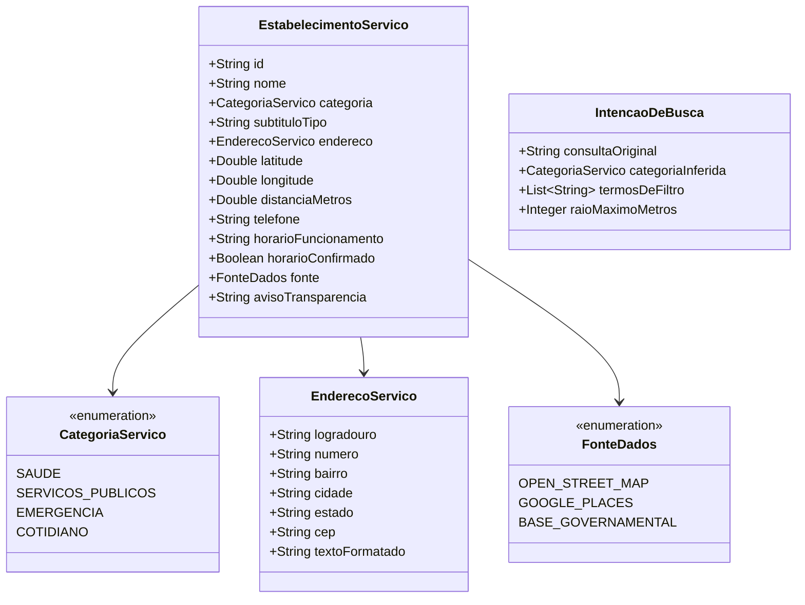

# Phase 1: Data Model & Entidades

## 1. Visão Geral do Modelo de Dados

Em total conformidade com a Constituição do Memora e a LGPD, o **Localizador de Serviços** opera predominantemente em modelo *stateless* e sob demanda no que tange a dados pessoais. **Nenhum rastro ou coordenada geográfica permanente do usuário é gravada no banco de dados relacional.**

As entidades dividem-se entre:
1. **Modelos de Domínio no Backend (Java/Spring)**: Representação normalizada dos estabelecimentos obtidos dos provedores geográficos.
2. **Modelos de Domínio no Frontend (Flutter/Dart)**: Entidades imutáveis para exibição de cartões e renderização no mapa acessível.

---

## 2. Diagrama de Entidades de Domínio

---

## 3. Especificação dos Atributos

### 3.1. `EstabelecimentoServico` (Entidade Principal de Resultado)

| Campo | Tipo | Descrição |
|---|---|---|
| `id` | `String` | Identificador único estável gerado a partir da fonte (ex.: `osm:node:123456`). |
| `nome` | `String` | Nome oficial do estabelecimento ou órgão público (ex.: *"UBS Jardim Boer"*). |
| `categoria` | `CategoriaServico` | Categoria primária para categorização visual e filtro. |
| `subtituloTipo` | `String` | Descrição amigável para pessoas idosas (ex.: *"Posto de Saúde Municipal"*). |
| `endereco` | `EnderecoServico` | Objeto com os componentes de endereço e linha formatada para leitura. |
| `latitude` | `Double` | Coordenada geográfica de latitude para cálculo de distância e marcação no mapa. |
| `longitude` | `Double` | Coordenada geográfica de longitude para cálculo de distância e marcação no mapa. |
| `distanciaMetros` | `Double?` | Distância geodésica em relação à origem da pesquisa (calculada via fórmula de Haversine). |
| `telefone` | `String?` | Telefone limpo e formatado para exibição e discagem acessível. |
| `horarioFuncionamento` | `String?` | Horário de atendimento simplificado (ex.: *"Segunda a Sexta, das 07:00 às 17:00"*). |
| `horarioConfirmado` | `Boolean` | `true` se a fonte for recente e confiável; `false` se houver incerteza. |
| `fonte` | `FonteDados` | Identificação transparente do provedor da informação. |
| `avisoTransparencia` | `String?` | Mensagem explicativa quando faltarem dados (ex.: *"Telefone e horário não confirmados pelo local"*). |

### 3.2. `CategoriaServico` (Enumeração de Domínio)

- `SAUDE`: Postos de saúde (UBS), hospitais, pronto-socorro, clínicas geriátricas, farmácias e laboratórios.
- `SERVICOS_PUBLICOS`: Agências do INSS, Poupatempo, Correios, CRAS, Cartórios, Receita Federal e Prefeitura.
- `EMERGENCIA`: Delegacias da Mulher/Polícia Civil, Bombeiros (193), SAMU (192), Polícia Militar (190).
- `COTIDIANO`: Agências bancárias e caixas eletrônicos, supermercados, feiras e padarias.

---

## 4. Política de Retenção e Privacidade (LGPD)

- **Coordenadas do Dispositivo**: Utilizadas estritamente em memória volátil durante a execução da busca e descartadas após a serialização do JSON de resposta.
- **Consultas em Linguagem Natural**: A consulta textual pode ser enviada ao Gemini API exclusivamente para extração de intenção de busca, aplicando as mesmas proteções da Emenda 1 da Constituição (sem transmissão de nomes, documentos ou identificadores pessoais).
- **Sem Rastreamento em Segundo Plano**: Nenhuma geolocalização é coletada quando a tela do Localizador está em segundo plano ou fechada.
