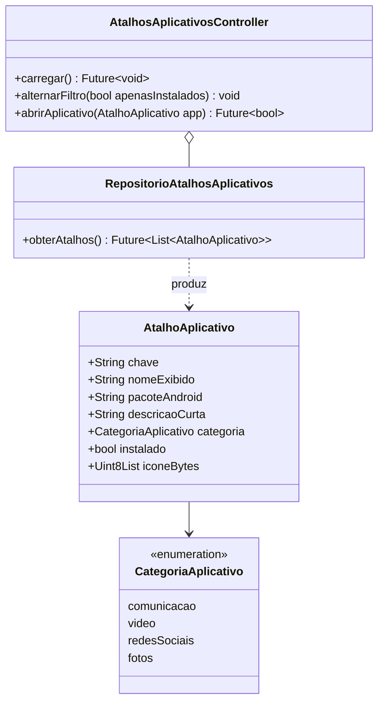

# Modelo de Dados: Feature 015 — Atalhos Rápidos para Aplicativos

**Feature**: Atalhos Rápidos para Aplicativos  
**Arquivo**: `data-model.md`  
**Escopo**: Entidades de domínio, enumerações e modelos de estado da camada de apresentação no Flutter.

---

## 1. Entidades de Domínio

### 1.1 `AtalhoAplicativo`

Representa um aplicativo suportado na tela de atalhos rápidos do Memora.

| Campo | Tipo | Descrição | Regras de Validação |
| :--- | :--- | :--- | :--- |
| `chave` | `String` | Identificador único interno (ex.: `'whatsapp'`, `'youtube'`). | Obrigatório, lowercase, sem espaços. |
| `nomeExibido` | `String` | Nome amigável exibido para o usuário (ex.: `'WhatsApp'`). | Obrigatório, texto não vazio. |
| `pacoteAndroid` | `String` | Nome do pacote no sistema Android (ex.: `'com.whatsapp'`). | Obrigatório, deve casar com `formaDePacote`. |
| `descricaoCurta` | `String` | Frase explicativa simples em linguagem sênior. | Obrigatório, máximo de duas frases curtas. |
| `categoria` | `CategoriaAplicativo` | Categoria funcional do aplicativo. | Enum tipado. |
| `instalado` | `bool` | Indica se o app foi detectado no dispositivo pelo sistema. | Padrão: `false` até resolução pelo canal. |
| `iconeBytes` | `Uint8List?` | Imagem PNG real do ícone fornecida pelo `PackageManager`. | Opcional; se nulo, exibe ícone nativo vetorial. |

### 1.2 `CategoriaAplicativo` (Enum)

Classifica o aplicativo para organização e semântica de acessibilidade.

- `comunicacao`: Aplicativos para troca de mensagens e chamadas (WhatsApp, Telegram).
- `video`: Aplicativos para exibição de filmes, músicas e vídeos (YouTube, TikTok).
- `redesSociais`: Aplicativos de relacionamento e notícias (Facebook, Instagram).
- `fotos`: Aplicativos de organização e armazenamento de memórias visuais (Google Fotos).

---

## 2. Modelos de Apresentação e Estado

### 2.1 `EstadoTelaAtalhos`

Estado imutável gerenciado pelo `AtalhosAplicativosController`.

```dart
class EstadoTelaAtalhos {
  final bool carregando;
  final List<AtalhoAplicativo> aplicativos;
  final String? mensagemAviso;

  const EstadoTelaAtalhos({
    this.carregando = true,
    this.aplicativos = const [],
    this.mensagemAviso,
  });

  /// Quantidade de aplicativos instalados detectados
  int get totalInstalados =>
      aplicativos.where((app) => app.instalado).length;

  /// Total de aplicativos suportados
  int get totalSuportados => aplicativos.length;
}
```

---

## 3. Catálogo Estático Imutável (`CatalogoAplicativosComuns`)

Lista pré-definida em código (sem dependência de banco de dados ou endpoints externos):

```dart
const List<AtalhoAplicativo> catalogoAplicativosPadrao = [
  AtalhoAplicativo(
    chave: 'whatsapp',
    nomeExibido: 'WhatsApp',
    pacoteAndroid: 'com.whatsapp',
    descricaoCurta: 'Mensagens de texto, áudios e chamadas com a família.',
    categoria: CategoriaAplicativo.comunicacao,
  ),
  AtalhoAplicativo(
    chave: 'youtube',
    nomeExibido: 'YouTube',
    pacoteAndroid: 'com.google.android.youtube',
    descricaoCurta: 'Vídeos, músicas, receitas e programas de TV.',
    categoria: CategoriaAplicativo.video,
  ),
  AtalhoAplicativo(
    chave: 'instagram',
    nomeExibido: 'Instagram',
    pacoteAndroid: 'com.instagram.android',
    descricaoCurta: 'Fotos e vídeos de parentes, amigos e criadores.',
    categoria: CategoriaAplicativo.redesSociais,
  ),
  AtalhoAplicativo(
    chave: 'facebook',
    nomeExibido: 'Facebook',
    pacoteAndroid: 'com.facebook.katana',
    descricaoCurta: 'Publicações, fotos e grupos de pessoas conhecidas.',
    categoria: CategoriaAplicativo.redesSociais,
  ),
  AtalhoAplicativo(
    chave: 'google_fotos',
    nomeExibido: 'Google Fotos',
    pacoteAndroid: 'com.google.android.apps.photos',
    descricaoCurta: 'Todas as suas fotos e recordações da família guardadas.',
    categoria: CategoriaAplicativo.fotos,
  ),
  AtalhoAplicativo(
    chave: 'telegram',
    nomeExibido: 'Telegram',
    pacoteAndroid: 'org.telegram.messenger',
    descricaoCurta: 'Mensagens rápidas, grupos de notícias e canais.',
    categoria: CategoriaAplicativo.comunicacao,
  ),
  AtalhoAplicativo(
    chave: 'tiktok',
    nomeExibido: 'TikTok',
    pacoteAndroid: 'com.zhiliaoapp.musically',
    descricaoCurta: 'Vídeos curtos, receitas rápidas e momentos divertidos.',
    categoria: CategoriaAplicativo.video,
  ),
];
```

---

## 4. Relações e Dependências


